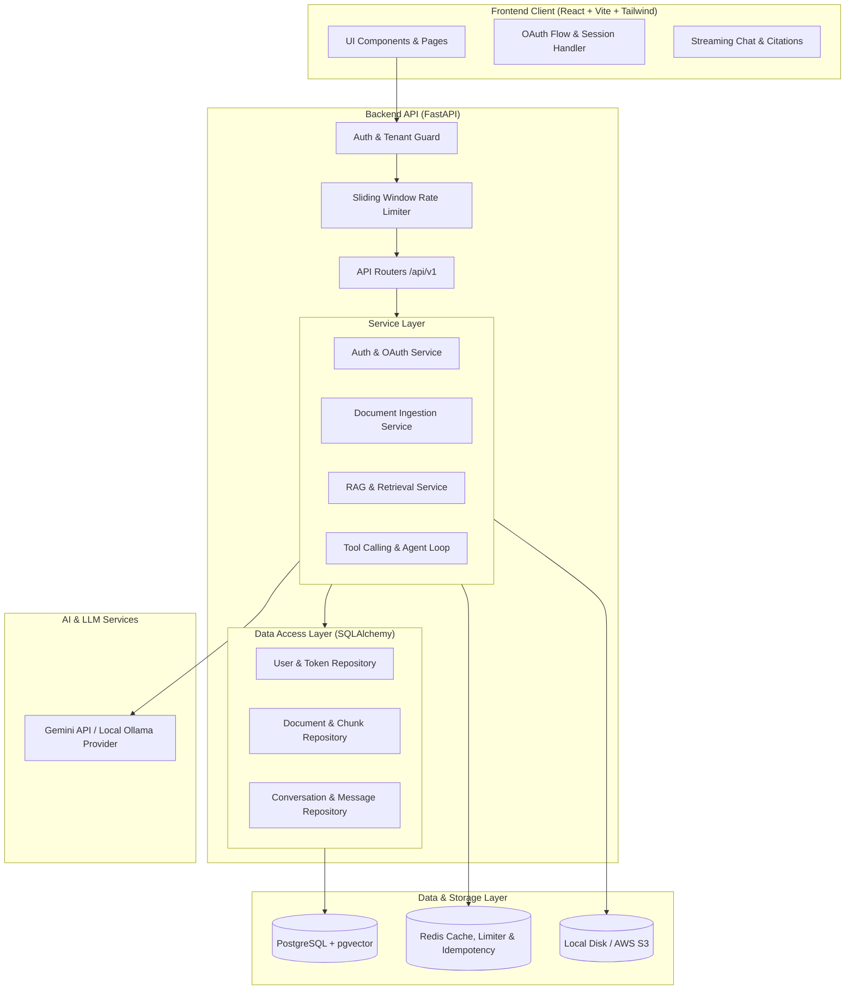

# DocMind - Architecture Specification

## 1. System Overview

---

## 2. Component Specifications

### 2.1 Frontend
- **Framework**: React 18+ bootstrapped with Vite, TypeScript, and Tailwind CSS.
- **Routing**: React Router v6+.
- **State Management & Fetching**: TanStack Query (React Query) for server state caching + Axios/Fetch for streaming (SSE) reader.
- **Key Views**:
  - OAuth Login & Redirect handler.
  - Document Dashboard: Upload dropzone, file list, processing status badge, delete, and structured summary viewer.
  - Chat Workspace: Conversation list, streaming token-by-token message feed, and interactive citation popovers.

### 2.2 Backend
- **Framework**: FastAPI (Python 3.11+).
- **Architecture Pattern**: Layered Architecture (Routers $\rightarrow$ Services $\rightarrow$ Repositories $\rightarrow$ Models).
- **Authentication**: OAuth 2.0 (Google OAuth flow). The backend receives the authorization code, exchanges it with Google for user identity info, creates/finds the user record in PostgreSQL, and issues a secure session token (HTTP-only cookie or rotating bearer token).
- **Asynchronous Processing**: FastAPI `BackgroundTasks` (interface designed so it can be swapped to Celery/Redis Queue without changing business logic).
- **Validation**: Pydantic v2 schemas for all request/response contracts and structured AI outputs.

### 2.3 Database & Vector Store
- **RDBMS**: PostgreSQL 16+.
- **Vector Extension**: `pgvector` with HNSW index using cosine distance (`vector_cosine_ops`).
- **ORM & Migrations**: SQLAlchemy 2.0 (asyncio) + Alembic.
- **Database Schema**:
  - `users`: `id` (UUID), `email` (unique), `name`, `avatar_url`, `created_at`
  - `user_sessions`: `id`, `user_id`, `session_token_hash`, `expires_at`, `revoked_at`
  - `documents`: `id`, `user_id`, `filename`, `content_hash`, `mime_type`, `size`, `storage_path`, `status` (`uploaded`, `processing`, `ready`, `failed`), `error`, `created_at`
  - `chunks`: `id`, `document_id`, `user_id`, `chunk_index`, `page`, `content`, `embedding` (vector($N$))
  - `conversations`: `id`, `user_id`, `title`, `created_at`
  - `messages`: `id`, `conversation_id`, `role`, `content`, `citations` (JSONB), `created_at`
  - `user_memories`: `id`, `user_id`, `key`, `value`, `updated_at`
  - `idempotency_keys`: `key`, `user_id`, `request_hash`, `response` (JSONB), `created_at`

### 2.4 Caching & Invalidation Architecture
- **Technology**: Redis 7+.
- **Query Cache Key**:
  $$\text{Key} = \text{hash}(\text{user\_id}, \text{normalized\_query}, \text{docs\_version})$$
- **Cache Invalidation**: Each user has an integer counter `docs_version` in Redis. Whenever a document is uploaded, updated, or deleted, `INCR docs_version:{user_id}` is executed. All previous cached query keys become unreachable and expire harmlessly via Redis TTL.
- **Rate Limiting**: Sliding window or token bucket algorithms implemented via Redis scripts.
- **Idempotency**: Cached API responses for mutative operations (e.g. document uploads) stored with a TTL.

### 2.5 GenAI & RAG Pipeline
- **Provider Interface**: Abstract Base Class (`LLMProvider`) implementing:
  - `embed(texts: list[str]) -> list[list[float]]`
  - `generate(prompt: str, **kwargs) -> str`
  - `stream(prompt: str, **kwargs) -> AsyncIterator[str]`
- **Supported Implementations**: Google Gemini API (default) and local Ollama.
- **Chunking Strategy**: Configurable chunk size (e.g., 500-1000 tokens) with overlap (e.g., 100-200 tokens) retaining page and section metadata.
- **Citations**: LLM prompt strictly instructs generating references using citation tags (e.g., `[[1]]`, `[[2]]`) mapped directly to retrieved chunk metadata (`document_name`, `page`, `chunk_index`).
- **Refusal Guardrail**: Explicit prompt instruction: if retrieved context does not contain sufficient factual evidence to answer, the model must explicitly state that the documents do not contain the answer.
